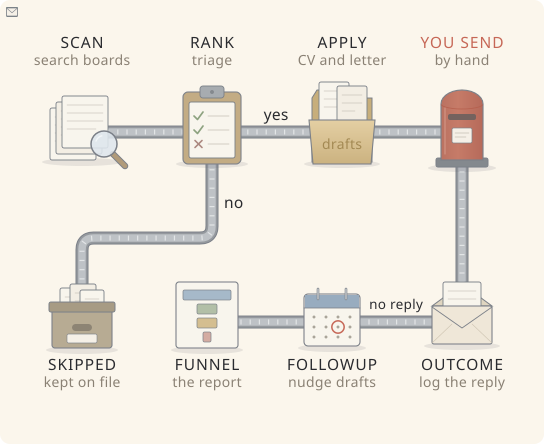
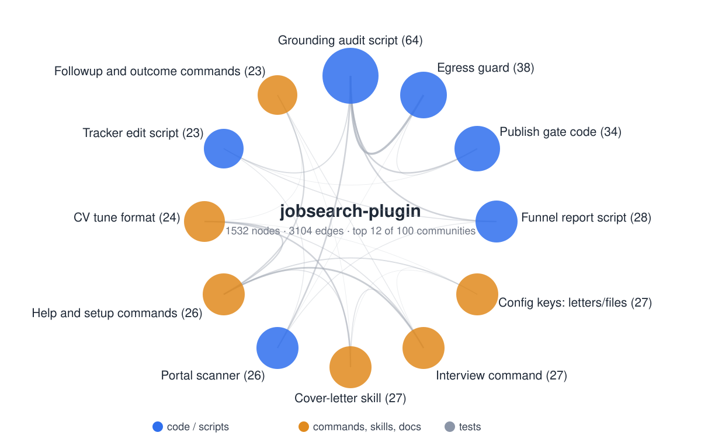

# Jobsearch for Claude Code and Codex

A job-search plugin for Claude Code and Codex that works as a neutral job-search engine for any profession. It triages vacancies, drafts honest cover letters, audits every claim against the user's own facts, and edits a tracker only through a safe script. It never sends, applies or submits anything.

Personal data (profile, tracker, applications, private config) lives in the user's own data folder. This repository holds none.

## What's inside

In Claude Code, the workflow uses 10 slash commands, called as `/jobsearch:<name>`, plus 6 helper skills. The Codex local edition builds the same 10 workflows as native skills (for example `$jobsearch-rank`) and includes the same 6 helpers. Startup, help, setup reminders and scanner messages use the active program's command names. Scripts do the deterministic work (tracker edits, audits, reports), so the model never edits the tracker by hand.

### Commands

| Command | What it does | Typical use |
|---|---|---|
| `rank` | Triages one or more vacancies (URL, pasted text, screenshot): host check, legitimacy observations, repost and duplicate check, blockers from config, requirement matrix, match %, verdict APPLY / NOT APPLY / ASK THE USER. Up to 10 vacancies per run; the rest is offered as the next batch. Optional location filter: Ukraine or not, remote or not (`--country`, `--remote`, defaults in `targets.country` / `targets.remote`); a vacancy whose location is not stated is never filtered out. Writes no CV and no letter. | You found a vacancy and want to know whether it is worth applying. |
| `apply` | Prepares one application: ATS pass, optional targeted CV copy, cover letter (drafter, reviewer, humanizer passes), then a mandatory grounding audit before hand-over. Never sends. Mode `tune`: ATS feedback and grounded English CV rewrite suggestions for one vacancy, or general feedback without a vacancy; a targeted CV copy only on request. | The verdict is APPLY and you want the letter and a checklist ready to send yourself. Or `tune`: see how to tailor your CV to one vacancy without inventing anything. |
| `outcome` | Records a reply, rejection, interview or silence in the tracker with valid statuses, via `tracker_edit.py`. Offers `/interview debrief` after an interview. | A company answered, or you decided it will not. |
| `followup` | Lists applications waiting for an answer for N days and drafts a short follow-up. Draft only. | A week or two passed with no reply. |
| `interview` | Interview support for a tracked application, in three modes. `prep` (default): likely questions mapped to your story bank, consistency brief, gap bridges, questions to ask, optional mock interview. `debrief`: captures what was asked and what went badly, writes a debrief file, tags gaps. `redflags`: checks the employer against your blockers and red-flag list as SEEN / NOT SEEN / ASK. | Before a call (`prep`), right after it (`debrief`), or when something feels off about an employer (`redflags`). |
| `upskill` | Skill-gap heat map from your real rejections and declined vacancies, with a prioritized learning plan and study order. Aggregate mode, one vacancy URL, or `roadmap`: a 12-month career map with monthly goals, certifications and networking. | You want to know which gaps actually cost you vacancies. |
| `funnel` | Read-only funnel report from the tracker: stages, reply rate by host class and role type, rejection reasons by gap tag, median days to first reply. | You want the numbers and patterns across all applications. |
| `scan` | On-demand scan of approved employer job boards (Greenhouse, Lever) for new vacancies, off by default. Lists candidates with country/remote filter and blockers, always shows what was filtered and why, and hands picked ones to `rank`. Never applies. | You follow a few employers and want their new QA roles without opening each board. |
| `jobsearch-setup` | Guided setup: language (UK/EN), targets, limits, English CV, confirmed facts/master, metrics, ATS read, base letters and approved links. New/empty skeleton only; `update` reviews an existing folder and changes selected answers after confirmation. | First run, once. |
| `help` | Shows every command (with its modes) and skill in one line each, the usual workflow and whether a data folder is set up. Works in any project, also before setup. Changes nothing. | You are new to the plugin, or forgot which command does what. |

### The path of a vacancy



One vacancy goes through six commands. The red postbox is the only step the plugin never does: you send the application yourself. The counts in the picture are made up (synthetic data). `help`, `jobsearch-setup`, `interview` and `upskill` are not steps of one vacancy and are left out on purpose. Download [vacancy-path.html](docs/img/vacancy-path.html) and open it locally to touch each station. Drawn with [Minicharts](https://april-zhu.com/minicharts) by April Zhu; rebuild with `python3 tools/build_vacancy_path.py` (needs node and a local Minicharts copy, neither is a plugin dependency). `tests/test_vacancy_path.py` fails when the commands and the picture drift apart.

### Skills

| Skill | What it does | Not for |
|---|---|---|
| `ats-screening` | ATS CV screening and job-match analysis, including PDF technical checks (text layer, hidden text, parsing risk). Reads English, Russian and Ukrainian. | Rewriting or tailoring a CV (`apply tune`), writing a letter (`cover-letter`). |
| `cover-letter` | Concise cover letters and application form answers for one vacancy, strictly from your facts file, master CV and letter knowledge base. Humanizer preserves the facts; a final grounding audit checks the rewrite. Invents nothing, never sends. | CV scoring (`ats-screening`), fact-checking a finished text (`grounding-audit`), tracker updates (`outcome`). |
| `grounding-audit` | Factual audit of CVs, letters and recruiter replies: every date, employer, metric, tool and claim is checked against your facts file and master CV, after the mechanical script pass. | Writing letters (`cover-letter`), ATS scoring (`ats-screening`). |
| `humanizer` | Edits formulaic wording while preserving the author's facts and supplied voice. Based on Wikipedia's "Signs of AI writing" guide; does not guarantee detector results. | Checking facts (`grounding-audit`), drafting a letter from scratch (`cover-letter`). |
| `linkedin-profile-optimizer` | Reviews or drafts LinkedIn headlines, About, Experience and skills from supplied sources. Separates documented search behavior from recommendations and explains how to check discovery without invented ranking scores. With a jobsearch data dir it lists conflicts with the master CV first, traces every line to the master CV or facts file (else NOT IN SOURCES) and runs the grounding audit. | Sending messages, applying, or making unrequested profile edits. |
| `career-paths` | Recommends 3-5 better-paid directions that fit your experience and gap table, with labelled evidence for each; salary figures only with source link, date, region and gross/net, never converted or averaged. | One vacancy's fit (`rank`), a study plan (`upskill`), offer negotiation. |

For LinkedIn help, ask Claude to review the profile sections you provide using `linkedin-profile-optimizer`, for example: "Review my LinkedIn About and headline against my supplied CV; suggest only grounded changes." It is a skill, not an extra file in the slash-command directory. It prepares suggestions; it does not update your profile automatically.

Plugin-level list with the scripts: `plugins/jobsearch/README.md`.

### Session-start context

A PreToolUse write guard (`plugins/jobsearch/hooks/guard_writes.py`) enforces hard rules 5 and 6 in code: Claude cannot write the tracker, the final CV files or the master CV directly, and must ask before editing the facts file. It denies recognized send/reply/apply/submit tools even with an approved destination. In the job-search project it also denies browser/computer interactions that can activate those controls; the user interacts with the page manually (hard rule 1). `tracker_edit.py` locks the tracker while it writes, so two sessions cannot lose each other's edit. The plugin also includes a read-only SessionStart hook (`plugins/jobsearch/hooks/session_start.py`). In the configured job-search project it first shows what each command and skill does (one line each, with its modes), then loads the overview and open TODO items (at most 30, plus a count of the rest) into Claude's context on startup, resume, clear or compact. It stays silent in unrelated projects, on data/config errors, or when the project already defines its own SessionStart hook. Details: the "Session-start hook" section of `plugins/jobsearch/README.md`.

### Coming next

Both approved addenda are shipped: CV tailoring (`/apply tune`) and the career pack (`/upskill roadmap`, the data-dir mode of `linkedin-profile-optimizer`, `career-paths`). The portal scanner (Greenhouse and Lever) ships off by default. The next planned phases are an application-form assistant and email reply-watch; see `docs/alternative-flow.md`. Ideas set aside on purpose, with the evidence that would bring them back, are in `docs/deferred-ideas.md`.

## Architecture map



Generated with [graphify](https://pypi.org/project/graphifyy/) from the repository itself: 1532 nodes, 3104 edges, 100 communities (the 12 largest non-test communities are shown). Blue: scripts and guards, orange: commands, skills and docs. Lines between circles show how many graph edges connect two communities. Download [graph.html](docs/graph/graph.html) and open it locally for the full interactive graph.

## Install in Claude Code

```
claude plugin marketplace add <github-owner>/jobsearch-plugin
claude plugin install jobsearch@jobsearch-marketplace
```

Run `/jobsearch:help` for an overview of what the plugin does. Then run `/jobsearch:jobsearch-setup`. It asks for a data folder, creates the skeleton (profile, tracker with header, config from the template, optional preset) in a new or empty folder only, and prints the `JOBSEARCH_DATA_DIR` line to put in your shell profile. The plugin never edits shell profiles.

## Data folder and config

The plugin finds your data folder in this order: (1) `JOBSEARCH_DATA_DIR`; (2) a `.jobsearch-data` marker file in the current project that contains the path; (3) a `jobsearch.config.yaml` in the current project's root, which makes the project itself the data folder. Nothing found means it stops and says so; it never guesses. Run `/jobsearch:jobsearch-setup` to create one. Settings live in `jobsearch.config.yaml` inside that folder; set `JOBSEARCH_CONFIG` to use a config kept elsewhere. Details and the `paths.*` keys: `plugins/jobsearch/reference/data-contract.md` (pointer page: `docs/data-contract.md`). Config template: `plugins/jobsearch/reference/config.template.yaml`.

## Privacy model

- The repo holds no personal value: no real names, employers, contacts, salary figures, vacancy ids or machine paths. Fixtures use a synthetic persona.
- The publish gate (`plugins/jobsearch/scripts/publish_gate.py`) takes its patterns from the user's private config, so it carries no personal value itself. It scans the working tree, the full git history and commit author and committer fields. The tree scan includes untracked files that git does not ignore, so list tool folders that are never committed in `.gitignore` or `.git/info/exclude`; a file added later with `git add -f` is scanned again. Claude Code's local checkpoint refs (`refs/time-machine/*`) are skipped: they are never pushed and only keep old local snapshots reachable. Run it before any push; a pre-push hook that calls it is installed by the user, not by this repo.
- The gate also looks for the data-folder path (`--data-dir PATH` or `JOBSEARCH_DATA_DIR`, as written and in its `~/` form) and prints whether that check is active.
- `publish_gate.allow` in the private config lists per-file exceptions (for example the copyright line in `LICENSE`): a hit is skipped only inside that exact file and only for text within the allowed value. Commit authors and messages, ref names and file names are never exempt.
- The validator skips the gate with a WARN when no private config is available.

## Where your personal data goes

What the plugin itself does with your profile, CV, tracker and config (checked 2026-11-04):
- **Stays on your machine:** everything personal lives in your data folder and your private config. The plugin's scripts read and write only there (the tracker only through `tracker_edit.py`, with a backup and a changelog).
- **No telemetry, no uploads:** no script sends anything anywhere. The only network calls in scripts are `robots_check.py`, which downloads a site's public `robots.txt`, and `portal_scan.py`, which fetches only the approved job-board endpoints and their `robots.txt` with a generic user agent. Neither sends anything about you.
- **Fetches send nothing personal:** commands fetch only the vacancy or employer URLs you give, plus web searches for study resources or salary ranges. The plugin's rules forbid opening links found inside a vacancy.
- **The scanner sends nothing personal either:** `/jobsearch:scan` (off by default) fetches only the job-board endpoints you approved, with a generic user agent, after a robots check.
- **Nothing is sent, posted or submitted on your behalf** (hard rule 1). You send every letter and every application yourself. The hook denies recognized final-delivery tools regardless of grants, and blocks browser click/type/fill/submit interactions in the job-search project.
- **Never in the public repo:** the publish gate blocks any push that contains your configured identity values, data-folder path or secrets.
- **Claude itself:** like any Claude Code session, the text you work with is processed by the model you use. The plugin adds no other recipient.

The egress guard (hard rule 8) blocks configured identity values in searches and fetched URLs, including percent-encoded values. Supported non-message connector writes and git/gh/curl/wget/scp/rsync transfers need an exact approved destination, a fresh explicit confirmation in chat and the hook's permission ask. Send/reply/apply/submit actions cannot be granted. Unknown connectors and generic executors (`js`, `execute`, `request`, etc.) are denied even with a destination grant or a `GET`/`read` hint. Read access uses exact built-in tool classifications in `hooks/egress.py`; unfamiliar tools require source review and classification before use. Classified connector reads also check their input for configured personal values. Git pushes require an approved private-repository entry. Configured outbound/protected writes fail closed if a check errors. Private visibility and the first chat confirmation are user attestations; the hook cannot verify them independently. It is not a sandbox for arbitrary executable code. See `docs/superpowers/specs/2026-11-04-egress-guard-addendum.md`.

## Hard rules

Never send or apply, facts only from the data folder, the tracker changes only through `tracker_edit.py`. They cannot be switched off by config: `plugins/jobsearch/reference/hard-rules.md`.

## Presets

`plugins/jobsearch/presets/qa/` is an example configuration for a manual QA search (an example, not a default). To write one for another profession: `docs/presets.md`.

## Opt-in alternative flow

Default job portals are Djinni (`djinni.co`), DOU (`dou.ua`), Indeed (`indeed.com`), Stepstone (`stepstone.de`), robota.ua (`robota.ua`), Work.ua (`work.ua`) and Jobico (`jobico.io`). New setups include them; existing configurations keep their own lists. Each domain still requires user confirmation before fetching. These entries classify vacancy links; they do not enable automatic scanning.

The portal scanner (`/jobsearch:scan`, Greenhouse and Lever) is shipped and off by default. An application-form assistant and email reply-watch are planned later phases, not shipped features. Their opt-in design and approval gates are documented in `docs/alternative-flow.md`.

## Tests and validator

```
PYTHONDONTWRITEBYTECODE=1 python3 -X dev -m unittest discover -s tests -v
python3 -B evals/validate_repo.py
JOBSEARCH_CONFIG=<private config> python3 plugins/jobsearch/scripts/publish_gate.py --repo .
```

Requires Python 3.9+. Python standard library only, with two optional extras for the `ats-screening` skill: PyMuPDF (`pip install pymupdf`) for `ats_technical_score.py`, and pdfplumber + pypdf (`pip install pdfplumber pypdf`) for `pdf_technical_check.py`. Each script says so when its extra is missing; everything else runs without them.

## Licence and notices

`LICENSE`. Third-party licences and credited ideas: `THIRD-PARTY-NOTICES.md`.

## Guided setup and languages

Run `/jobsearch:jobsearch-setup` for a new folder or `/jobsearch:jobsearch-setup update` to review existing answers and skipped steps. The wizard confirms each save, backs up overwrites after two separate confirmations, and creates a master CV only once. Final CV files remain read-only. Run `plugins/jobsearch/scripts/onboarding.py` with `status` to see missing pieces without exposing profile values.

Chat is Ukrainian or English. CVs, master CVs and tune output are English; supply an English CV rather than asking the wizard to translate facts. Letters are Ukrainian or English, following the vacancy when possible; otherwise the user chooses. `base_en` and `base_uk` base letters are audited before being agreed. The plugin does not manufacture the required user confirmations.

## Install and use in Codex

Build a new local marketplace with `python3 tools/build_codex.py --out <absolute-new-marketplace-folder>`, then add that folder with `codex plugin marketplace add <absolute-new-marketplace-folder>` in your own Terminal and install through a supported desktop plugin browser. Review/trust its hooks and start a new chat. The builder creates an independent package from shared sources; it copies no private data and changes no installed plugin/settings. Full instructions and the command mapping: [Codex edition](docs/codex.md).

Invoke `$jobsearch-help`, `$jobsearch-setup`, `$jobsearch-rank`, `$jobsearch-apply` and the other named skills, or select them in the UI. Helper skills, startup/help output, missing-setup reminders and script errors show Codex names; Claude continues to show `/jobsearch:...` commands. Both editions use the same external private data folder and config.

## Behavior in Claude Code

Native slash commands and `ask`/`deny` hooks support the guided wizard and the two-step outbound procedure. New CV/master creation asks; existing final CV/master writes are denied. Facts/config changes ask. Configured personal values in WebSearch/WebFetch are blocked. Supported non-message writes require an exact approved destination and fresh confirmations. Recognized final sends/submissions and unknown/generic connectors are denied; applications and messages remain drafts.

## Behavior in Codex

Codex's current hook does not support `ask`: it can report an error and continue that call. This edition converts every such decision to deny, so the user performs the protected save or approved outbound action manually. Analysis, prepared materials and unprotected draft/report writes use the shared workflows. Native apply_patch paths are checked. Never disable a guard or switch tools to evade the block.

Hosted WebSearch is outside Codex's hook path. The skills require a local preflight for each exact query/URL before use; this is procedural, not automatic interception. Hooks require a supported local runtime and explicit trust. A missing executable, timeout or untrusted hook cannot be described as fail-closed protection. The edition is for manual local installation, not the public OpenAI plugin directory. [Runtime limits and user checks](docs/codex.md).

## Pre-release architecture audit

The [2026-11-04 audit](docs/audit-2026-11-04.md) records reproduced gaps and their regressions. Repairs cover valid YAML frontmatter, protected paths across Bash/MCP/downloads/symlinks, effective push destinations, ambiguous network arguments, data scope across nested/workdir calls, readiness checks and short role tokens. New setup binds both data-dir and config variables explicitly; text-only CVs never receive an invented PDF technical score.

The two audit policy decisions are implemented for both hosts: final sends/submissions always deny, and unclassified/generic connectors deny before grants. Local drafts remain available; supported non-message connector writes still need exact grants (Claude asks, Codex blocks for manual execution). These controls cover supported tool paths. See the [runtime limits](docs/codex.md).

Current version: 1.0.4 (see the [changelog](plugins/jobsearch/CHANGELOG.md)). It is tagged `v1.0.4` and published as a GitHub Release (2026-11-12). [Live smoke checks on synthetic data](docs/audit-2026-11-04.md#follow-up-verification) passed in Claude Code and Codex at `d57712e` (the 1.0.0 candidate). Later commits, including 1.0.1 to 1.0.4, passed the automated suite (433 tests) but have no live smoke check in the refreshed installations. Full first-time onboarding and real-board scanning remain outside the verified scope.
